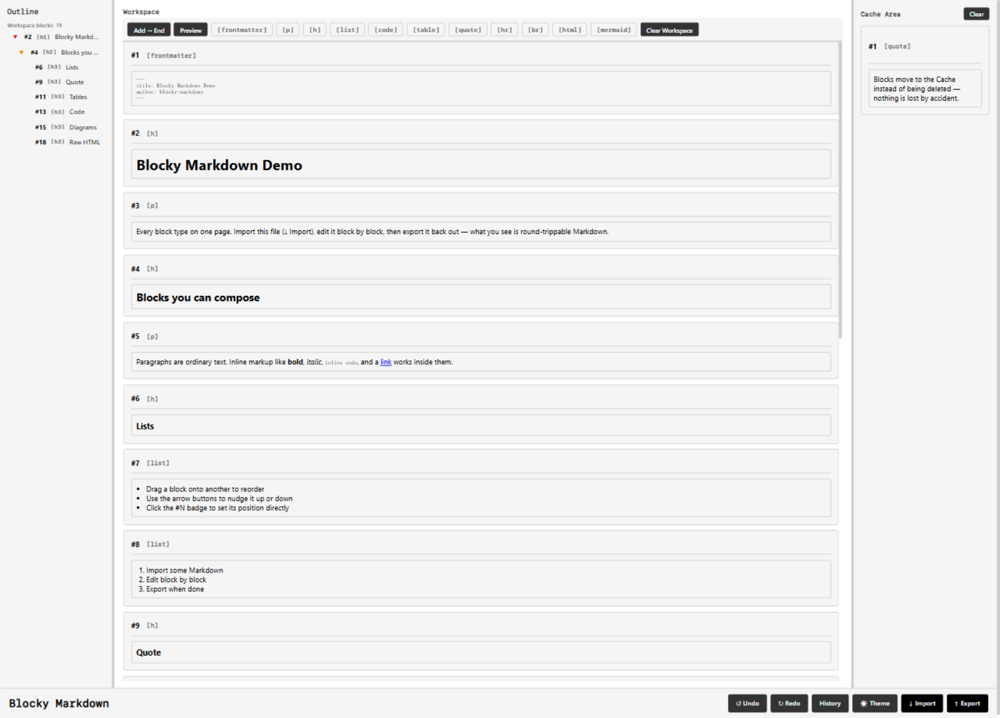

# blocky-markdown

A minimalist, framework-free markdown editor with a block-based interface and hierarchical document navigation.

<p align="center">
  
</p>

## Features

Outline, workspace and cache in three resizable columns; 11 block types; a light and a dark theme; a table editor and a link editor; drag-and-drop block management; import and export with frontmatter; content persisted to localStorage; no build step.

### Hierarchical Outline

- Lists every block with an icon; heading levels H1-H6 carry their own indentation
- Collapsible sections via ▼/▶; clicking an item jumps to that block
- Reflects changes immediately

### Resizable Layout

- 3 columns — Outline | Workspace | Cache — with draggable dividers between them
- Each sidebar runs from 150px min to 500px max; the layout collapses to a vertical stack on mobile

### Enhanced Table Editor

- Split view: grid on the left, content editor on the right; clicking a cell edits it in the dedicated textarea
- Rows and columns add and remove dynamically; every operation preserves the content
- "Insert Link" button inside the cell editor

### Link Editor

- Available in paragraphs, lists and table cells through the "Insert Link" button
- Fields: link text, URL and optional title; the link lands at the cursor position
- Emits `[text](url "title")` markdown

### Block Management

- Drag and drop blocks between the workspace and the cache; border highlights mark the drop targets
- Move buttons ↑↓ swap adjacent blocks; the button row appears on hover and stays visible on touch
- The cache holds blocks instead of deleting them; permanent delete lives in the cache, behind a confirmation

## Theme System

- **Daytime (default)** — clean black and white design, monospace fonts for clarity, no decorative elements, distraction-free writing
- **Nightcore (dark mode)** — subtle dark colors (#1A1A1A background), not pure black, good contrast for readability and easier on the eyes over long sessions

Toggle between themes with the ☀/🌙 button in the header.

## Supported Block Types

All blocks use clean HTML-style tags (no emojis):

- **Text** — `[p]` paragraph blocks, `[h]` headings (H1-H6 with level selector), `[list]` ordered and unordered lists, `[quote]` blockquotes
- **Structure** — `[frontmatter]` Jekyll/Hugo YAML front matter, `[hr]` horizontal rule, `[br]` line break
- **Code and markup** — `[code]` code blocks with language tags, `[html]` raw HTML blocks
- **Rendered** — `[table]` interactive table editor, `[mermaid]` Mermaid diagram support

## Usage

### 1) Import

- Serve the folder with any static file server and open it there — native ES modules do not load over `file://` (e.g. `python -m http.server` or `npx serve`). No build step.
- Click **↓ Import**, paste Markdown (frontmatter supported), confirm. Consecutive paragraphs auto-merge; a history snapshot is taken.
- Or paste the bundled [`example.md`](./example.md) — a one-page tour of every block type, from tables to Mermaid diagrams.

### 2) Edit

- **Add blocks**: toolbar tags ([p], [h], [list], etc.). Toggle **Add → Start/End** to choose the insertion point.
- **Outline**: heading-only list with level-colored toggles (shown only when children exist). Click once to toggle + jump.
- **Reorder**: drag blocks (before/after targets); move buttons (top/up/down/bottom) or clicking the **#N** label reinsert by array order. Move to **Cache** or restore to workspace end.
- **Inline vs. focus edit**: click a block to edit inline; use **Edit/Done** for focus mode. The tip bar (bottom) shows contextual hints.
- **Preview**: the **Preview/Edit** toggle renders the whole workspace; each block also renders its own markdown in place (Marked, with a plain-text fallback).
- **Undo/Redo**: buttons or **Ctrl+Z / Ctrl+Y**. History limit configurable via **History** (default 100). **Clear Workspace/Cache** available. Resizers adjust column widths. Tooltips on buttons, outline, toggles and block controls.

### 3) Export

- Click **↑ Export** (or **Ctrl+S**) to open the export modal; copy or download the rendered Markdown.

### 4) Experience settings

- **Theme**: ☀/🌙 toggle (persists locally).
- **History limit**: set via the **History** dialog.
- **Auto-save**: content persists to localStorage automatically.
- **Preview toggle** and **tips bar** monitor the current action or the hovered control.

## Technologies Used

- **HTML5** structure; **CSS3** dual theme with CSS variables; **JavaScript (ES Modules)** application logic, loaded natively with no build step
- **Marked.js** markdown parsing (with fallback); **DOMPurify** sanitizes HTML before it enters the preview pane
- **Mermaid.js** renders mermaid diagrams in the preview (lazy-loaded when needed)

## Browser Compatibility

Works in all modern browsers supporting native ES modules, CSS Grid and Flexbox, CSS Custom Properties, the LocalStorage API, the Drag and Drop API, and mouse events (for resizing).

## Known Limitations (local use)

1. **History lives in memory** — undo/redo stays inside the session, capped at 100 steps by default (configurable), and is lost on reload.
2. **Preview runs no page scripts** — preview HTML is rendered by `marked` and sanitized by DOMPurify, so inline scripts and styles never execute; Mermaid diagrams render lazily.
3. **Import/export fidelity is limited** — `MarkdownUtils.parseImport` in `js/utils/markdown.js` works on line-level rules, so setext headings, `~~~` fences, aligned tables and nested lists are unsupported. HTML blocks accumulate line by line until a line with a closing tag appears, so a self-closing tag alone on a line (e.g. `<p>...</p>`) swallows the lines after it — keep HTML blocks at the end of the document, the way the bundled `example.md` is organized. `MarkdownUtils.exportBlocks` in the same file concatenates `content` only, so complex Markdown round-trips deform and frontmatter is recognized only at the file start.
4. **Touch and keyboard support is thin** — panel dividers and drag-and-drop listen to mouse and HTML5 drag events only (`setupResizer`, `DragDropManager`), so touch devices cannot resize or reorder and no keyboard alternative exists.
5. **Block editing drops format details** — the table editor rebuilds cells with a single-line `<input>` (`TableEditorManager.confirm`), keeping column alignment markers but not multi-line cell content; code-block language tags only match `\w+` (the `BlockFactory` regex skips `c#` and `c++`), so those languages get truncated.

## Development

Unit tests for the markdown parsing logic use the Node.js built-in test runner (Node 18+, no dependencies):

```bash
node --test
```

## License

MIT License - See LICENSE file for details
